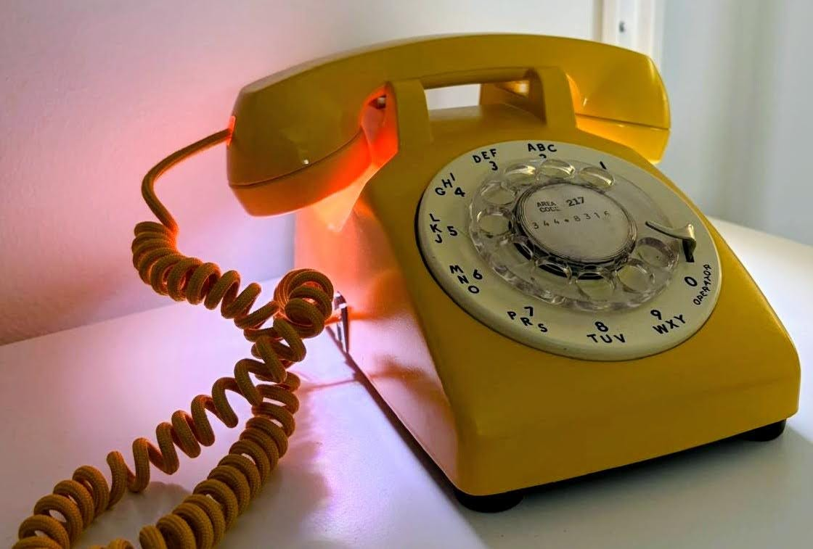
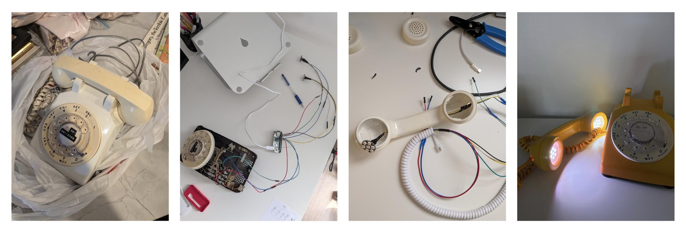

Back in June, I was at my parents’ house the day after they’d cleaned out an old storage closet, and among the books and doodads scattered about their kitchen was an old rotary phone destined for the donate pile. I’d been searching for a rotary phone for a few months at that point. I had randomly thought that it’d be fun to make a retro-looking lamp out of one, and so, slowly but surely over the next four months, I did just that.

I spent 50-ish hours of my occasional downtime just building this phone/lamp[^1]: I figured out how to wire a Raspberry Pi to the rotary phone’s dial; learned to make a coiled wire using a lightning cable, paracord, and a hair dryer; and overthought[^2] all the little details.

On the surface, I spent an absurd amount of effort just to end up with a mediocre desk lamp. After all, if my goal were to brighten up my desk, I could have just purchased a retro lamp online for $30 and a few clicks. But the point wasn’t to just *have* a lamp — I didn’t even need a lamp! The point was to *make* a lamp and really understand how it worked. The *process* was the point.

This process — the slow, methodical digging to really understand something — has been one of the things I’ve loved most about my roles as a Researcher / Data Scientist over the past many years. With the industry’s broad adoption of AI tooling, though, it’s also become what I’m most worried about losing. The judgement and creativity we get to employ when designing studies, interpreting data, and crafting compelling narratives have been at the heart of “research” for as long as it’s existed; and I can’t help but feel a persistent anxiety[^3] that AI tools are quickly eroding their place in the work.

In Research, and in so many other fields, the finished analysis/article/deck/lamp matters, of course, but the real value comes from the hundreds of small decisions that produce it, because that’s where true understanding is created. *Really* understanding something can’t happen by “taking a shortcut to the center” — it happens “in the detours.”[^4]

None of this means AI has no place in the work — these tools are genuinely good at plenty of things. The challenge is to leverage what they do best *without sacrificing the whole point of the work*. After much trial & error and countless conversations with friends, I’ve settled on a set of guiding principles that outline when and how I try to use AI in my workflow — making sure these tools serve the process, rather than optimizing it away. I’m sharing the principles here both to hold myself accountable and in hopes that articulating them is helpful to others navigating the shift in their work.

### My guiding principles for using AI in Research:

1. **Only delegate tasks to AI that I’m (mostly) capable of doing myself.** If I can’t do a task manually, I usually won’t know enough to judge the quality of an AI’s output. When I *do* explore something new, I treat it as a learning project and review the results with colleagues who are fluent in that area.
2. **Prescribe exactly what to do and how to do it.** Rather than handing over the goal and letting the tool run wild, I try to direct it to use specific approaches, steps, and methods, so that I can still find the understanding that “happens in the detours.”
3. **Start with a “blank page” and use AI additively**, building things up piece by piece. I almost never use AI to generate a full draft to then manually chisel down.
4. **Be transparent about methods and take responsibility for the output.** I always disclose when and how AI tools were used in the research process[^5]. I only share AI-contributed work after a thorough audit and if I’d be comfortable claiming it as my own.

I treat these as guiding principles, rather than rigid rules, and I **adhere to principles 1–3 most, but not all, of the time.** They don’t fit every situation, and it’s worth deliberately and cautiously deviating from them to experiment as AI tools evolve.

In practice, these guiding principles mean I’m comfortable using AI to do things like catch bugs in code I’ve written, convert a one-off code block into a loop, and poke holes in a methodology I’ve already drafted. But I usually avoid using these tools for things like formulating core research questions, writing code or study plans from scratch, and synthesizing data into a final narrative.

While the efficiency of AI tooling is tempting, these principles aim to preserve the friction and detours that give research its purpose. Keeping them in the back of my mind ensures these tools serve the craft, protecting the very parts of the process that make the work worth doing.

Of course, choosing friction over efficiency comes with its own trade-offs: The phone lamp sits on our bookshelf now, unplugged, because I’m afraid my shoddy soldering will make it explode. And when I *do* plug it in, it takes three minutes to boot up before the clashing-color LEDs turn on. Any cheap lamp I could buy online would be better, but I’d have no idea how it works.

---

### A few reading/watching recommendations on this topic:

* [In Defense of the Detour: On craft, A.I. and what gets lost when we skip the slow part](https://www.nytimes.com/interactive/2026/09/27/opinion/ai-art-creativity.html?unlocked_article_code=1.NlE.UJoE.YMNysqdR2cTt), by Giorgia Lupi in the New York Times. “The greatest contributions to humanity — art, inventions, even products — show evidence of people who got lost in a problem and came out the other side with an idea they would not have found otherwise. That does not happen by taking a shortcut to the center. It happens in the detours.”
* [The Score](https://www.penguinrandomhouse.com/books/735252/the-score-by-c-thi-nguyen/), by C. Thi Nguyen. Explores how play, craft, and art derive value from “autotelic” struggle, rather than external metrics. Chapters 2, 21, 26, and 27 are most relevant.
* [The Craft of Writing Effectively](https://www.youtube.com/watch?v=vtIzMaLkCaM), lecture by Larry McEnerney at the University of Chicago. A lecture on using writing as a means of thinking, rather than just being a way to convey your ideas.
* [The Biggest Tell That Something Was Written by AI](https://www.theatlantic.com/technology/2026/05/how-to-tell-ai-writing/687345/), by Eve Fairbanks in The Atlantic. “When we use AI to flesh out ideas, we lose the most important part of the writing process: thinking… But the effort and the hang-ups are, as they say, a feature of the human thought process, not a bug.”
* [Refusing to accept an AI-poisoned future of journalism](https://www.thehandbasket.co/p/refusing-to-accept-big-tech-s-ai-poisoned-future-of-journalism), by Marisa Kabas / The Handbasket. “I don’t write because it’s fun (though sometimes it is.) I write because it feeds my spirit. It helps me unspool my thoughts and feelings in the hopes of helping others do the same. The process is the purpose. You don’t have to always like or enjoy the process, but if you don’t respect it enough to do it yourself, there is no purpose.”
* [Will it Lamp?](https://www.willitlamp.com/) by Clay Mohrman and Rory Shamlian. A bunch of neat lamps.

[^1]: A “phlamp,” if you will. Or maybe a “glowtery phone,” if you won’t.

[^2]: My favorite pastime.

[^3]: Also my favorite pastime.

[^4]: This framing comes from Giorgia Lupi in their recent New York Times piece, which I highly recommend. I cried a little bit the first time I read it.

[^5]: I wrote this blog post using my human brain, and then used artificial intelligence to critique it. I also had natural intelligence (my human wife, Kelsey, a talented writer) critique it further.
